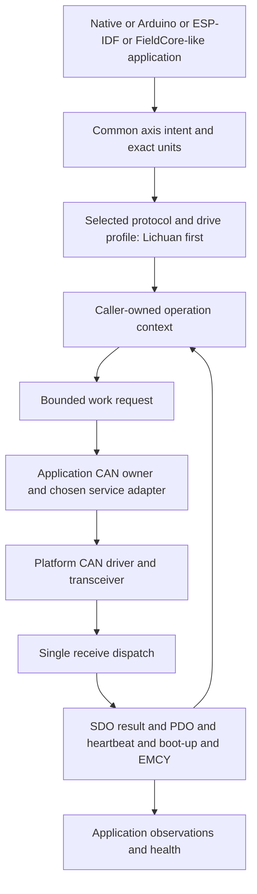

# MotorControl-CAN architecture plan

This is the proposed implementation contract, based on the 23 October 2026 source audits and [multi-drive decision](multidrive_decision.md). No files in the planned tree below are claimed to exist yet. The implementation agent must refresh the audits and record deliberate refinements before freezing public API.

Apply the concrete [conventions](prompts/CONVENTIONS.md), [documentation](prompts/DOCUMENTATION.md), [maintainability](prompts/MAINTAINABILITY.md) and [delegation](prompts/DELEGATION.md) contracts. They refine this layout with exact names, selected example health/counter rules, per-stage Doxygen and model-aware work allocation.

## Product and family boundary

Build one library for **multiple manufacturers' CAN-controlled stepper and servo drives**. Common motion intent, units, evidence and ownership are independent of motor technology and CAN protocol. Classical CANopen/CiA402 is the first backend; the first implemented family is Lichuan CL/OL C, beginning with CL86-C. Treat CL86-C, OL86-C, CL57-C and OL57-C as separately tracked capability entries even where they share implementation. Model, interface variant, firmware, manual dialect and active motor/feedback configuration determine support.

Use documented Nanotec N5 stepper/BLDC configurations and maxon EPOS4 CANopen as mandatory design contrasts before API freeze. Keep proprietary CAN profiles feasible through a separate protocol boundary. These are research/contract references, not installed placeholder drivers. CL-R/CL-RX, EtherCAT E-series, other interface variants, CAN FD, torque/cyclic modes and synchronized trajectories require explicit implementation/qualification; names or CiA402 marketing do not establish them. See the [drive survey](audit/CANOPEN_DRIVE_SURVEY.md), [other protocols](audit/OTHER_CAN_PROTOCOLS.md) and [new-profile playbook](prompts/ADD_DRIVE.md).

The initial common operations use drive-generated trajectories for either motor class. Current/torque, impedance and cyclic streaming remain explicit extension scopes rather than prerequisites for servo support. Full declared profile coverage means every documented native object/function in that scope is accounted for and every confirmed supported operation has a typed API and tests. A raw accessor, an EDS catalogue, or an UNSUPPORTED stub alone does not satisfy that requirement. Unresolved documentary behavior remains a named gap that prevents a full-support claim for that feature. Only the selected Lichuan family currently has a full implementation assignment; candidates do not automatically multiply that scope.

## Proposed source layout

```text
MotorControl-CAN/
  AGENTS.md  README.md  CHANGELOG.md  LICENSE  library.json
  CONTRIBUTING.md  SECURITY.md  Doxyfile  .clang-format
  CMakeLists.txt  cmake/MotorControlCANConfig.cmake.in
  platformio.ini  boards/                         # example board only when known
  include/MotorControlCAN/
    MotorControlCAN.h  Version.h  Status.h
    Units.h  Axis.h  ReadOperation.h  ActionOperation.h
    MoveOperation.h  VelocityOperation.h  Discovery.h  Traffic.h
    can/Frame.h  TransportCapabilities.h         # protocol-neutral Classical CAN
    canopen/Service.h  Network.h  Pdo.h           # first protocol backend
    canopen/Cia402.h                             # only reviewed shared primitives
    profiles/lichuan_c/
      Types.h  Objects.h  Codec.h  Reads.h  Discovery.h
      Actions.h  Position.h  Velocity.h  Homing.h
      DriverSettings.h  Io.h  Communication.h  Persistence.h
  src/
    Units.cpp  Axis.cpp  Discovery.cpp  Traffic.cpp
    can/  canopen/                              # framing separate from first protocol
    profiles/lichuan_c/
  examples/
    common/CanBusOwner.*  CanTransport.h  LichuanCanValidator.*
    common/Esp32Twai.*  BoardPins.h              # framework-specific boundary
    common/                                     # optional stack adapter, caller-owned
    units_preview/main.cpp                      # offline, sends nothing
    native_probe/                               # fake transport and optional SocketCAN
    probe_cli/ProbeApp.*  ProbeConsole.*  ProbePlatform.h
    probe_cli/ArduinoPlatform.cpp               # shared app/CLI, thin startup
    probe_idf/CMakeLists.txt  main/IdfPlatform.cpp
  test/
    fakes/  installed_consumer/                  # RS-equivalent consumer checks
    units_test.cpp  axis_test.cpp  can_codec_test.cpp
    sdo_test.cpp  network_test.cpp  pdo_test.cpp
    lichuan_*_test.cpp  can_owner_test.cpp  console_test.cpp
    multidrive_contract_test.cpp                # N5/servo/protocol contrast fixtures
    bench_*_test.py                              # registered; no hardware by default
  scripts/
    verify.py  check_repository.py  generate_version.py
    generate_lichuan_objects.py  check_lichuan_operations.py
    prepare_references.py  requirements-verification.txt
    bench_probe.py  bench_motion.py  bench_repeat.py
    bench_scenarios.py  bench_session.py  _bench_evidence.py
  .github/workflows/verify.yml
  docs/
    README.md  getting_started.md  source_map.md  architecture.md
    axis_contract.md  profile_contract.md  cli_contract.md
    can_owner.md  canopen_services.md  fieldcore_handoff.md
    verification.md  bench_scenarios.md  hardware_bench.md
    lichuan_api_cli_coverage.md  backlog.md  roadmap.md
    audit/  baseline/  reference/  prompts/  reports/  releases/
```

Mirror responsibilities and established names; omit unused empty abstractions. Final filenames may consolidate small cohesive types. Never create a placeholder header just to match this tree. A later real drive adds `profiles/<family>/`; a different protocol adds its independently implemented service boundary, without another physical receive owner. Contrast fixtures remain under `test/` and are not advertised drivers. Reference snapshots and vendor files are excluded from core builds/install/export. Catalogue generation is deterministic and checked in; core consumers do not need Python or network access.

## Ownership and dependency direction

| Concern | Reusable core | Application/adapter |
| --- | --- | --- |
| Units, scale, coordinate frames and quantization | Pure validation and exact arithmetic | Supplies explicit scales/origin/limits and provenance |
| Native objects and operations | Reviewed descriptors, typed codecs, capability checks | Selects protocol/family/firmware, logical axis and motor/feedback configuration |
| Motion/action sequences | Concrete fixed contexts; work/event/result functions | Owns contexts, drives service turns and policy |
| CANopen services | Pure frame validation/service descriptions; bounded protocol state only if selected | Owns chosen stack, channel storage, callbacks and CAN controller |
| Reception | Protocol-specific decoding of validated evidence | One receiver routes the selected domain's events; CANopen includes SDO/PDO/heartbeat/boot-up/EMCY |
| Bus ownership | No I/O or scheduler | Fair admission, urgent capacity, deadlines, queue generation, cancellation |
| State and health | Typed observations, raw errors and pure projections | Caches, freshness thresholds, counters and health transitions |
| Time | Explicit supplied monotonic time/durations | Clock acquisition, wrap extension and scheduling |
| Faults/recovery | Preserves uncertain outcomes and invalidation rules | Controller recovery; reconciles nodes, never resumes motion implicitly |
| CLI and persistence | Same typed public operations as all callers | Parsing, JSONL, host config and explicit save operations |



One local owner does not prohibit other CAN nodes from transmitting. Ordinary per-axis sequence reservation does not stop processing another node's heartbeat/PDO. SDO serialization is per actual channel, with a documented bounded channel table and cross-node fairness; it is not an RTU-style global receive lock. NMT/CiA402/SDO are optional protocol-specific facts, not required common axis fields. Common identity maps to a logical axis, with node/channel/subaxis in the protocol binding. Default each physical interface to one selected protocol domain; mixed protocols require explicit route/identifier/broadcast/frame-format compatibility analysis.

The owner uses `admit/admitUrgent/service/result/release/cancel`, following current RS source. Stages 06 and 07 implement its service/event storage incrementally; stage 12 integrates that same storage, not another node table or receiver. The stage-02 architecture proof is a small prototype, migrated into the real build in 03 and production units/contrast tests in 04. Application-only `Health` and `Stats` follow CONVENTIONS; communication health never substitutes for drive/motion state.

## Decide the service implementation before coding it

Stage 02 must compare a pinned CANopenNode integration with a bounded service subset implemented locally. Use the existing RS feasibility decision as background and inspect the actual stack API/license/port requirements. Prefer a proven stack when it satisfies resource/ownership needs. The decision must include a buildable proof, ownership/allocation accounting, supported services, error/timeout semantics, testability, package dependency effects and an upgrade policy.

The installed axis/profile core must not require a framework or chosen stack. If a stack is selected, the adapter translates yielded service work/results and the stack alone performs SDO/PDO transactions. Pure frame/object decoders remain useful, but do not add a second active transaction engine. If a local subset is selected, justify it, declare precisely which CANopen services it implements, and implement all services needed by the reviewed native surface. Do not market a few expedited SDO messages as a complete CANopen master. LSS, block transfer or SYNC need not exist merely because the standard defines them; their necessity comes from confirmed device/workflow scope.

## Protocol invariants

- Classical CAN frames retain 11/29-bit identifier, DLC, actual payload length, data/RTR flags and payload. An RTR frame carries no data even when its DLC requests a nonzero response length; do not equate DLC with stored payload length globally. Reject unexpected RTR/extended frames at a profile/service requiring standard data frames, not globally. FD requires a separate qualified adapter/frame capability and is not initially implemented. CAN CRC/ACK belong to the controller; do not add Modbus CRC, silent intervals or UART echo stripping.
- Match expected COB-ID/channel, node binding, command, index/subindex, size and service state before publishing SDO payload. Preserve full 32-bit abort codes. Segmented transfer is needed for any supported object exceeding expedited capacity; bind toggle/length/buffer rules to a bounded session.
- Local correlation tokens are useful for callers but absent from SDO wire messages. Timeout followed by an identical request can be ambiguous. Define channel retirement/quarantine/reconciliation and explicit uncertain results; do not claim a local generation solves a physically indistinguishable late reply.
- PDO interpretation requires the actual reviewed mapping and mapping generation. No default-map assumption after reboot or an uncertain remapping write. Remap transactionally under required NMT conditions, disable before editing when required, preserve failure state, read back, and never silently mark a partially applied map valid.
- Boot-up, NMT state, heartbeat deadlines, controller bus-off, drive status/mode, EMCY and application health are separate. Observe events even when there is no active command. If the selected node's effective heartbeat producer time is zero or unknown, absence alone may prove nothing; zero is not a universal all-vendor default. Drive-side consumer/watchdog capability and reaction must be established separately.
- All TX queues, including SDK/controller pending work, participate in epoch invalidation and stop/recovery handling. Hardware arbitration and retransmission can delay a frame after software admission. Track queued/physically sent/confirmed/unknown separately.
- Reserve stop capacity and define occupied-channel interruption. Quick-stop/halt semantics must come from the actual profile and option-code behavior. NMT stop/reset, disable voltage and communication silence are not substitutes for an evidenced motor stop.

The SDO/PDO/NMT rules above apply to the first CANopen backend. Other protocols keep their own response matching, no-ack/uncertainty, feedback and watchdog semantics. Drive-generated completion need not imply zero final velocity. An explicitly leased setpoint refresh is current intent under a profile service contract, not permission to replay an uncertain discrete move. A finite onboard trajectory can also require such servicing: model the exact documented refresh, avoid restarting a relative move/trajectory, and preserve uncertainty if safe refresh cannot be established. The first release does not implement generic streaming; that does not permit disabling a required device watchdog implicitly.

## Lichuan evidence gates

Current English/Chinese manuals and EDS disagree in relevant places. The implementation must maintain explicit document/firmware dialect evidence. In particular, do not synthesize a statusword mask by OR-ing all bits described across versions. Do not assume generic CiA402 target-reached semantics or blindly copy standard examples. Verify the state graph, mode transition, trigger edges, target acknowledgement and completion behavior for the selected profile.

The manufacturer describes relevant ramp objects as **time in milliseconds**. This is not automatically physical acceleration, even where a CANopen object has a familiar acceleration name. Retain raw time units and use a separate, justified conversion if a common acceleration quantity is offered. Likewise, RS `speedRpm`, signed native RPM widths, boot scale, zero assumptions and the ESS tested envelope do not define CAN behavior.

Persistence/reset objects, node/bitrate changes and I/O function assignments are explicit typed operations. No copied factory defaults, automatic factory restore or write-to-identify probe. Full source conflicts and page references belong in [the protocol audit](audit/DEVICE_PROTOCOL_RESEARCH.md) and the stage-01 ledger.

## Consumer compatibility

The current FieldCore tree contains a dormant RS motor module and independent motor admission/wire/execution states. Use its actual source as an integration test of the proposed boundary; do not copy its application types into public headers or assume it has an existing CAN owner. Provide a small fake consumer exercising the same prepared-work/event/result relationship. Document prospective CAN owner/device module work in this repository only. No FieldCore edit or product integration is included here.

Support ordinary native compilation first. Arduino and native ESP-IDF examples share application, console and CAN ownership code with platform-only adapters. Pin and inspect the actual SDK; the audited RS workflow uses ESP-IDF 5.5.5 and pioarduino 55.03.311, which are starting references, not evidence that a new adapter works. No S3 PSRAM or GPIO assignment becomes a prerequisite for portable library use.
