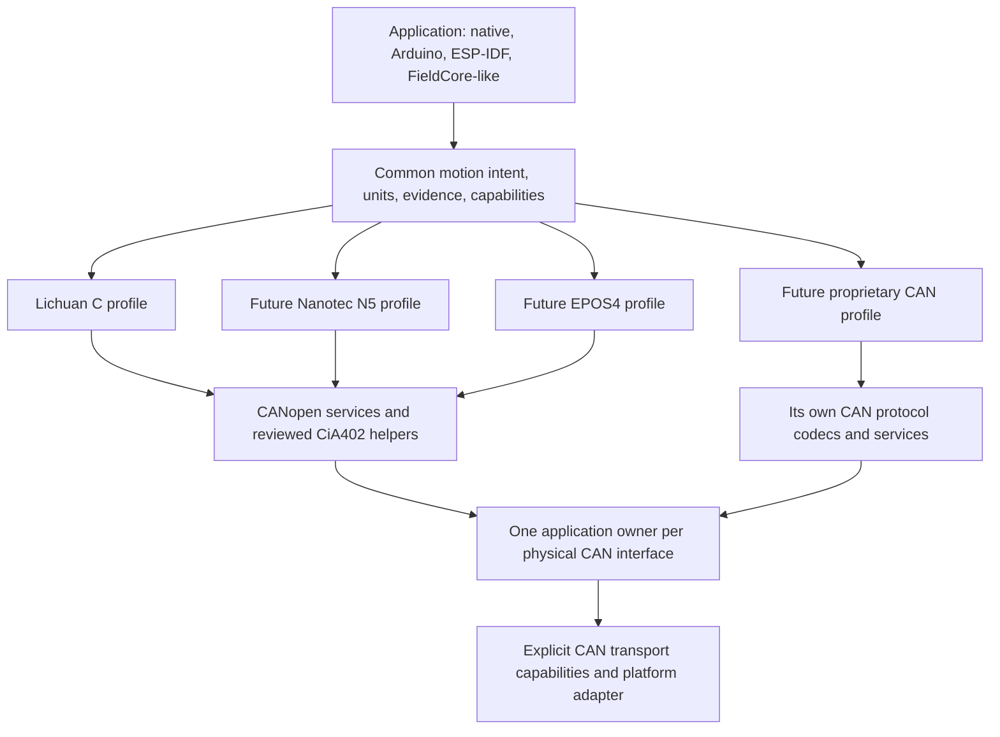

# One CAN motion library for stepper and servo drives

Decision date: 23 October 2026. **Design MotorControl-CAN for both stepper and servo drives from multiple manufacturers.** Keep one framework-independent motion vocabulary and independently selected protocol/device profiles. Implement Classical CANopen/CiA 402 and the Lichuan C family first. Use Nanotec N5 and maxon EPOS4 as mandatory contrasting designs before freezing the API. Other CAN protocols are future independent backends, not presumed CANopen devices.

This extends the original Lichuan-only planning scope. It does not claim any driver implementation or physical compatibility. The supplied source snapshots and original Lichuan audits remain historical evidence.

## Why one library is feasible

CiA 402 explicitly covers servo drives and stepper motors, with shared state/operation concepts; optional functions and partial implementations still limit interchangeability. Motor technology therefore does not justify splitting the public library. A concrete example is Nanotec N5: its CANopen manual covers open/closed-loop stepper control and closed-loop BLDC control in the same controller family. [CiA 402 overview](https://www.can-cia.org/can-knowledge/cia-402-series-canopen-device-profile-for-drives-and-motion-control), [Nanotec N5 CANopen manual](https://www.nanotec.com/us/en/products/manual/m/n5-canopen-en/index.html).

Position, velocity, homing, enable/release, explicit stop, observations, coordinates, limits, command uncertainty and ownership can share meanings. Actual wire values, supported modes, feedback/scales, ramps, state transitions, watchdogs, brakes and native configuration remain profile-specific. The library commands a drive's motion controller; it does not run motor commutation or a host servo loop merely because it supports a servo motor.

Keep capabilities independent of labels such as stepper, servo, open-loop or closed-loop. A servo speed controller may lack position control; a closed-loop stepper drive may support sophisticated position functions. For example, maxon distinguishes EPOS4 position/speed/current control from ESCON2 speed/current control without position control. [maxon controller selection](https://support.maxongroup.com/hc/en-us/articles/360015382019-EPOS4-ESCON2-ESCON-What-controller-should-I-select).

## Recommended scope and order

| Priority | Target | Role and scope |
| --- | --- | --- |
| Initial implementation | Lichuan CL86-C and documented CL/OL 86C/57C variants | Full confirmed native family scope from the original assignment; firmware contradictions remain explicit gates |
| Mandatory API design reference | Nanotec N5-1-2/N5-2-2 CANopen, manual 3.3.0 / FIR-v2213 scope | Tests that the same architecture can represent both stepper and BLDC servo operation; strongest next profile candidate |
| Mandatory independent servo contrast | maxon EPOS4 CANopen variants | Checks feedback, scaling, state/mode, brake and torque semantics against a dedicated servo ecosystem; later implementation candidate |
| Additional CANopen candidates | Nanotec C5-E CANopen variants; FAULHABER Motion Controller V3 CANopen; Delta ASDA-A2-M; Kollmorgen AKD CANopen variants | Reviewed market/design candidates; exact product interface and firmware need a separate profile audit |
| Later non-CANopen candidate | ODrive CANSimple | Useful proof that common motion does not require NMT/SDO/PDO or integer-only native wire values |
| Further protocol candidates | VESC CAN, moteus | Different packet formats, effort semantics, timing and/or CAN FD; separate backend and adapter qualification |

The ranking is an engineering recommendation based on protocol fit, documentation and contrast value, not a procurement or stock/price recommendation. See [CANopen survey](audit/CANOPEN_DRIVE_SURVEY.md), [other CAN protocols](audit/OTHER_CAN_PROTOCOLS.md) and [fresh source audit](audit/MULTIDRIVE_SOURCE_REAUDIT.md) for the actual product evidence and limits. Do not advertise these candidates as supported because they appear in this table.

The source pack includes four additional CANopen manuals and pinned ODrive/moteus/VESC documents or source files. Some maxon/Kollmorgen originals were readable through web research but blocked direct download; Delta's proposed PDF redirected to a terms page. Those items are recorded as remote-only, with no invented local file/hash. Obtain exact firmware-matched EDS/manuals before implementing a second real profile; these retrieval limits do not block the common architecture decision.

The next concrete profile should be **Nanotec N5 CANopen**, once there is an implementation assignment or available hardware. It proves both motor classes on a single documented interface and exposes the assumptions the Lichuan-specific design could otherwise hide. EPOS4 supplies a second vendor's dedicated servo contrast. The present implementation assignment still prioritizes completing Lichuan; it does not expand automatically into full implementations of every surveyed drive.

## Architecture boundary

These are extension relationships, not implemented modules. Do not generate empty folders or stub drivers for the candidates. Static profile selection or a small explicit table is sufficient; no heap-based plugin system, universal transaction engine or dependency on MotorControl-RS is needed.

The common layer must not assume a 7-bit CANopen node ID, object dictionary, NMT state, heartbeat, statusword, SDO acknowledgement, command RPM, subdivision, encoder presence or a single axis per physical controller. A host logical axis binding maps to protocol-specific endpoint/channel/address/subaxis data. Frames and service requests retain their actual native shape. Standard CiA402 helpers live below common motion and are used only where the reviewed profile supports their semantics.

Concrete contrasts demonstrate why this boundary matters: N5 documents eight Rx/Tx PDO sets while the Lichuan EDS supplies four, and vendor object `0x2300` controls NanoJ on N5 but save/factory reset on Lichuan. Resource bounds and vendor action meanings belong to a selected profile, never to a universal object-number table. [Document/page evidence](audit/CANOPEN_DRIVE_SURVEY.md).

## Changes required for servo and multiple vendors

| Concern | Required behavior |
| --- | --- |
| Identity | Separate manufacturer, product/interface variant, firmware, protocol, motor/feedback configuration and qualification; no universal identity probe |
| Units | Keep command increments, motor full steps, encoder counts, electrical rotations, mechanical rotations and load coordinates distinct; full-step concepts are optional |
| Numerical representation | Exact integer/rational host targets; checked explicit quantization to native integers or float formats; report error instead of assuming all native targets are exact counts |
| Velocity/ramp | Preserve physical intent and profile-native units; mechanical RPM, electrical RPM and encoder/user units require explicit scale/pole-pair evidence; milliseconds are not automatically acceleration |
| Torque/current | Separate current setpoint/measurement/limit, q-axis current, estimated torque, physical torque and per-mille rated values; a current limit is not a torque control mode |
| Feedback | Distinguish commanded, actual, estimated and externally observed position/velocity; optional load encoder and feedback loss are explicit |
| Readiness | Mode, commutation/calibration/reference, enable and brake requirements are profile facts; selecting a profile never calibrates or enables it |
| Stop/release | Hold, ramped stop, quick stop, coast, drive disable and brake action are distinct capabilities; a shared name does not imply identical electrical/mechanical behavior |
| Completion | Report transport/device/controller-observed evidence separately; profiles lacking a correlated acknowledgement or completion indication cannot fabricate them |
| Timing | Drive-generated finite trajectories first; cyclic setpoints, effort/impedance control and coordinated motion require a separate timing/watchdog contract |
| Health | Common application health remains separate from optional native network/drive states; absent CANopen concepts are not reported as fictitious successful states |
| Native access | Typed native extensions retain meaningful vendor features; common capability rejection does not erase the native coverage ledger |

Common APIs retain MotorControl-RS names where meanings match: `prepareMoveAbsolute`, `prepareMoveRelative`, `prepareMoveAngle`, `prepareVelocity`, `prepareHome`, `prepareStop`, `prepareEnable`, `prepareRelease`, typed reads and concrete `next*`/`advance*` contexts. Do not inherit `uint16_t speedRpm`, `int16_t nativeRpm` or serial-tuple fields just because the names are shared.

Current/torque and cyclic modes are **extension scopes**, not prerequisites for calling a position-controlled motor a servo. Keep them capability-described and accessible through appropriately scoped typed native APIs when a profile implements them. Add a common effort/streaming API only with a concrete implemented device, explicit units, duration/deadlines/watchdog and measured transport requirements. Do not expose empty `prepareTorque` or cyclic API promises in the first release.

When a later profile requires periodic setpoint/watchdog service, including during a finite onboard trajectory, distinguish an explicitly leased refresh of current intent from replaying an uncertain discrete move. Each refresh revalidates binding/configuration/mode/intent generation and a bounded deadline; reboot or uncertain state revokes the lease. Confirm from the protocol that the refresh does not retrigger a relative move or restart the trajectory. No implicit watchdog disable or repeated unknown trigger is allowed. A native trajectory-complete flag may allow nonzero final velocity, so done, settled, stationary and physically observed stop remain distinct evidence.

## CAN itself is another explicit boundary

Use a protocol-neutral Classical CAN frame boundary supporting 11-bit and 29-bit identifiers, data/RTR flags and up to eight data bytes. RTR has no payload even when DLC requests a nonzero response size, so DLC and actual data length are distinct facts. CANopen profiles may reject extended/RTR frames where their service requires standard data frames; that rejection must not be global because other protocols use them. Keep identifier/flags/DLC/receive metadata intact.

CAN FD is a separate transport capability and implementation milestone, not a 64-byte reinterpretation of the Classical CAN type. A profile requiring FD must reject on a Classical-only adapter before admission. The initial ESP32-S3 example remains Classical CAN. Do not force every small embedded core consumer to allocate FD storage now; add the concrete bounded FD frame/adapter path when a real profile is implemented. The public logical motion target must not prevent that extension.

ODrive's CANSimple uses its own identifiers/messages and parameter-access protocol, even where names contain SDO; VESC and moteus differ again. Their protocol objects never flow through a CANopen state machine. [ODrive CAN protocol](https://docs.odriverobotics.com/v/latest/manual/can-protocol.html), [other protocol evidence](audit/OTHER_CAN_PROTOCOLS.md).

One library can control different protocols on separate CAN interfaces. Sharing the same physical bus additionally requires an explicit compatibility analysis: bitrate/frame format, identifier ownership and collisions, broadcasts, responses, bus load and watchdog timing. Different numerical node IDs do not prove non-overlap between protocols. Default to one selected protocol domain per interface; reject overlapping routes. Never broadcast or probe unknown devices with another protocol's frame patterns.

## What readiness must prove

Stages 01–04 must compare Lichuan with the actual N5 manual and EPOS4 evidence before API freeze. Stage 02 builds bounded **test-only contrast fixtures** expressing N5 stepper/BLDC and source-backed EPOS4 capabilities through the same common intent/ownership types, with documented widths, units and outcomes where available. They are not installed drivers or advertised support; missing native-sequence evidence is not invented. Stage 17 verifies these contrasts plus a non-CANopen routing/representation fixture, using real documented protocol shapes without emulating unsupported capabilities.

Acceptance requires that the documented N5/EPOS4 contrasts fit common units, logical axis identity, result uncertainty and core ownership without vendor-specific assumptions. This is evidence for the selected boundary, not a promise that unknown future requirements can never change an API. New typed profile contexts and documented capability additions are expected; protocol services and native state remain optional dependencies.

For this promptset, build core-only and selected-Lichuan consumers plus the combined test-only contrasts. Reuse and extend the same small fixtures across stages 02, 04 and 17; do not implement fake N5/EPOS4 operation engines to satisfy a packaging gate. Add production profile-subset and two-profile package checks when a second real profile is implemented under ADD_DRIVE. Check now that unused catalogue strings and optional stack dependencies are not forced into minimal consumers.

For actual new-drive work use [ADD_DRIVE.md](prompts/ADD_DRIVE.md). A profile is not complete because its constants are in a table or it returns UNSUPPORTED. Record separately: researched, contract-fixture tested, implemented subset/full native scope, firmware built and physically qualified. Full support remains bounded by the declared model/interface/firmware/features.
